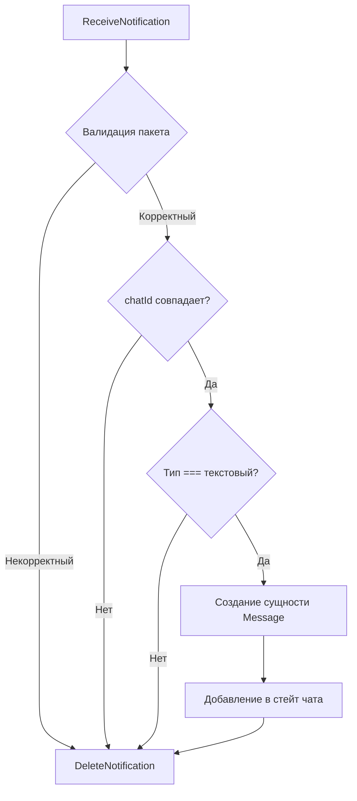

# 💬 WhatsApp Chat Application

Простое веб-приложение для отправки и получения текстовых сообщений в WhatsApp с использованием сервиса [GREEN-API](https://green-api.com/). Проект выполнен в рамках тестового задания с акцентом на чистую архитектуру и отказоустойчивость.

✨ **Основная особенность**: Реализация механизма Long Polling для мгновенного получения сообщений без разрыва сессии и корректная обработка лимитов API.

---

## 🛠 Технологический стек

-  — разработкаа пользовательского интерфейса
-  — типизация приложениея
-  — запуск и сборка проекта
-  — стилизация компонентов
-  — маршрутизация приложения
- **Feature-Sliced Design (FSD)** — архитектурная методология
- **ESLint** 

---

## 🚀 Возможности приложения

- **Авторизация**: Быстрое подключение к аккаунту GREEN-API.
- **Управление чатами**: Создание диалога по номеру телефона с автоматической валидацией и нормализацией ввода.
- **Обмен сообщениями**: Отправка, мгновенный прием и наглядное отображение входящих/исходящих сообщений.
- **Фильтрация данных**: Показ входящих уведомлений исключительно для текущего активного чата.
- **Безопасность очередей**: Автоматическое удаление обработанных задач из очереди GREEN-API.
- **Отказоустойчивость**: Обработка превышения лимитов запросов к API (`quotaExceeded`).

---

## 🏗 Архитектура проекта

Приложение организовано по методологии **Feature-Sliced Design**. Ниже представлена структура директорий слоя `src/` и описание ключевых зон ответственности.

```text
src/
├── app/              # Инициализация приложения, глобальные стили и провайдеры
│   ├── styles/
│   └── App.tsx
├── pages/            # Компоненты страниц (экранов) приложения
│   ├── auth/         # AuthPage — подключение и валидация инстанса GREEN-API
│   └── chat/         # ChatPage — рабочее пространство текущего чата
├── features/         # Реализация конкретных пользовательских сценариев
│   ├── connect-api/  # Проверка состояния инстанса при входе
│   ├── send-message/ # Логика формирования и отправки сообщения
│   └── receive-message/ # Прием и конвейерная обработка входящих пакетов
├── entities/         # Бизнес-сущности предметной области
│   └── message/      # Сущность сообщения (модели данных, элементы UI)
└── shared/           # Переиспользуемая инфраструктура
    ├── api/          # Базовый API-клиент для интеграции с greenApi
    ├── lib/          # Утилиты и хелперы (валидация/нормализация телефонов)
    └── ui/           # Глобальные базовые UI-компоненты (кнопки, инпуты)
```

---

## 🔄 Взаимодействие с GREEN-API

Проект использует три ключевых метода сервиса: `SendMessage`, `ReceiveNotification` и `DeleteNotification`. Обновление чата происходит с помощью техники **polling** — последовательных периодических запросов.

### Конвейер обработки входящего уведомления:



### ⚠️ Обработка сценария `quotaExceeded`

При фиксации события превышения лимитов тарифа со стороны API:

1. Приложение переключается в состояние `quotaExceeded`.
2. Поллинг новых сообщений временно приостанавливается.
3. В интерфейсе пользователя отображается предупреждающий баннер.

---

## 💾 Хранение данных

Параметры авторизации инстанса (`apiUrl`, `idInstance`, `apiTokenInstance`) изолированно сохраняются в **`sessionStorage`**.

- Данные доступны на протяжении активной вкладки браузера.
- При закрытии вкладки или перезапуске сессии авторизационные токены полностью удаляются.

---

## 💻 Инструкция по запуску

### 1. Установка зависимостей

```bash
npm install
```

### 2. Запуск в режиме разработки

```bash
npm run dev
```

После успешного запуска перейдите по локальному адресу, который отобразит Vite в терминале (обычно `http://localhost:5173`).

---

## 📘 Руководство пользователя

1. **Подключение**: На стартовом экране укажите ваши `API URL`, `ID Instance` и `API Token Instance` из личного кабинета GREEN-API. После валидации параметров произойдет переход к чату.
2. **Создание диалога**: Введите номер телефона собеседника. Система отсечет лишние символы и приведет строку к международному стандарту.
3. **Отправка и прием**: Наберите сообщение в текстовом поле. Приложение моментально обновит UI и очистит очередь уведомлений на сервере после успешной обработки.

---

## 🚫 Ограничения текущей версии

Данная сборка является MVP и на текущий момент поддерживает **исключительно текстовые сообщения**.
Приложение игнорирует и не отображает следующие типы медиа-сообщений:

- Изображения и фотографии
- Видео и аудиозаписи
- Документы и любые форматы сторонних файлов

---

## 🔗 Полезные ссылки

- **Официальный сайт**: [GREEN-API Platform](https://green-api.com/)
- **Техническая база**: [Документация GREEN-API](https://green-api.com)
